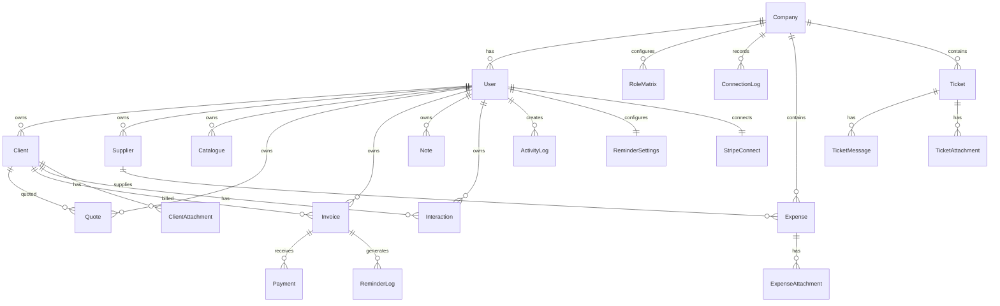

# CRM Roberto Database Schema

Last updated: 2026-07-13

The database layer uses MongoDB with Mongoose models in `db/models`. Most financial amounts are stored as integer cents where the model name includes `Cents`; quote/invoice line-item totals are stored as numeric values used by existing calculation helpers.

## 1. Entity Relationship Overview

## 2. Identity And Company Models

### User

Purpose: Application user, session subject, role owner, invitation target, and audit actor.

Important fields:

- `name`, `email`, `password`, `locale`
- `isOnboardingComplete`, `onboardingGuideSeenPages`, `isEmailVerified`
- `account_status`: `active`, `suspended`
- `companyId`: reference to `Company`
- `role`: `super_admin`, `administrator`, `manager`, `standard_user`, `secretary`, `technician`, `read_only`, `external_accountant`
- `invitationStatus`: `none`, `pending`, `accepted`, `revoked`, `expired`
- `invitedBy`, `invitationTokenHash`, `invitationExpiresAt`
- `accessRevokedAt`, `forceLogoutAfter`, `lastLoginAt`, `failedLoginCount`, `lockedUntil`

Indexes:

- Unique `email`
- `companyId`
- `role`
- `invitationStatus`
- `accessRevokedAt`
- Compound `{ companyId, role }`

### Company

Purpose: Company/workspace container.

Important fields:

- `name`, `slug`
- `status`: `active`, `suspended`
- `ownerUserId`
- `featureFlags`: `expenses`, `tickets`, `financialDashboard`, `accountantPortal`, `exports`, `advancedRoles`
- `suspendedAt`, `deletedAt`

Indexes:

- Unique `slug`
- `status`
- `ownerUserId`
- `{ ownerUserId, status }`
- `{ createdAt: -1 }`

`featureFlags` is the per-company license/module configuration managed from the Super Admin portal. It gates the corresponding Company CRM and Accountant Portal features.

### Admin

Purpose: Separate Super Admin portal identity. Admin users do not share the standard CRM `User` session model.

Important fields:

- `name`, unique normalized `email`
- `password`: hidden from normal query selection

### RoleMatrix

Purpose: Per-company overrides for assignable Company CRM role permissions when the `advancedRoles` feature is enabled.

Important fields:

- `companyId`, `role`, `moduleKey`, `updatedBy`
- `permissions`: `canView`, `canCreate`, `canEdit`, `canDelete`, `canExport`, `canManage`

Indexes:

- Unique `{ companyId, role, moduleKey }`

### ConnectionLog

Purpose: Platform-facing sign-in and access-event audit log, including Accountant Portal sign-in attempts.

Important fields:

- Optional `userId`, optional `companyId`, `role`
- `eventType`: `login_success`, `login_failed`, `logout`, `portal_login_success`, `portal_login_failed`, `force_logout`, `revoke_access`, `impersonation_start`, `impersonation_stop`
- `ipAddress`, `userAgent`, `deviceLabel`

Indexes:

- `{ companyId, createdAt: -1 }`
- `{ userId, createdAt: -1 }`
- `{ eventType, createdAt: -1 }`
- `{ companyId, userId, eventType, createdAt: -1 }`

### CompanyProfile

Purpose: Legal, contact, billing, bank, and logo profile for documents.

Important fields:

- `user`: unique owner reference
- `companyName`, `ownerName`, `phone`, `businessEmail`
- Address: `streetNumber`, `streetName`, `postalCode`, `city`, `country`, `address`
- Legal: `vatNumber`, `rcsNumber`, `businessAuthorizationNumber`, `matriculeNumber`, `legalIdentifier`
- Banking: `iban`, `bankName`
- Logo: `logoUrl`, `logoKey`

## 3. CRM Models

### Client

Purpose: Customer account/person used in notes, interactions, quotes, and invoices.

Important fields:

- `user`
- `clientType`: `company`, `individual`
- `fullName`, `email`, `phone`, `address`, `addressDetails`
- Company/legal fields: `companyName`, `vatNumber`, `rcsNumber`, `businessAuthorizationNumber`, `matriculeNumber`
- Contact fields: `title`, `firstName`, `lastName`, `responsibleEmail`, `billingEmail`, `companyPhone`, `privatePhone`, `mobilePhone`
- Billing/bank fields: `billingAddress`, `bankName`, `iban`
- `additionalDescription`

Indexes:

- Text index on name/email/phone/company/contact fields
- `{ user, createdAt: -1 }`

### Supplier

Purpose: Vendor/supplier records used by expenses and supplier notes.

Important fields:

- `user`, `fullName`, `contactName`
- `category`: `materials`, `logistics`, `services`, `technology`, `other`
- `email`, `phone`, address fields, `companyName`, `vatNumber`, `iban`, `notes`
- `tags`: `important`, `pending`, `partner`

Indexes:

- Text index on identity/contact/address fields
- `{ user, createdAt: -1 }`
- `{ user, category, createdAt: -1 }`
- `{ user, tags, createdAt: -1 }`

### Note

Purpose: Follow-up notes linked to clients or suppliers.

Important fields:

- `user`, `title`, `description`
- `linkedType`: `client`, `supplier`
- `linkedId`
- `followUpDate`

Indexes:

- `{ user, createdAt: -1 }`
- `{ followUpDate: 1 }`
- Text index on `title`, `description`

### Interaction

Purpose: Client timeline events.

Important fields:

- `user`, `clientId`
- `type`: `call`, `meeting`, `email`, `discussion`
- `title`, `notes`, `date`, `followUpDate`

Index: `{ user, clientId, date: -1 }`

## 4. Catalogue Model

### Catalogue

Purpose: Product/service library used as source line items for quotes and invoices.

Important fields:

- `user`, `name`, `description`
- `type`: `product`, `service`
- `priceExcludingTax`, `priceIncludingTax`, `vatRate`
- `currency`: currently `EUR`
- Attachment metadata: `attachmentUrl`, `attachmentKey`, `attachmentMimeType`, `attachmentName`

Indexes:

- `{ user, createdAt: -1 }`
- `{ user, type }`
- Text index on `name`, `description`

## 5. Quote Model

### Quote

Purpose: Commercial offer with immutable client snapshot, line items, totals, public signature token, and conversion status.

Statuses:

- `draft`
- `sent`
- `accepted`
- `refused`
- `rejected`

Signed statuses:

- `not_signed`
- `signed`

Important fields:

- `user`, `quoteNumber`, `quoteNumberYear`, `quoteNumberSequence`
- `date`, `status`, `signedStatus`, `statusHistory`
- `clientId`, `clientSnapshot`
- `lineItems`: product/catalog or custom line data, quantity, base price, discount, VAT, totals
- Totals: `totalExcludingTax`, `totalExcludingTaxBeforeDiscount`, `totalDiscountExcludingTax`, `totalVat`, `totalIncludingTax`
- `rejectionComment`, `notes`, `paymentTerms`, `validityDays`, `subject`
- Signature: `signatureToken`, `signatureTokenExpiry`, `signedAt`
- Conversion: `convertedToInvoice`, `invoiceId`
- Client conversation: `rejectedSignToken`, `adminReplyMessage`, `conversationMessages`
- Document URLs: `quotepdfUrl`, `invoicepdfUrl`
- `ownerHasUnread`

Numbering:

- Canonical format: `DEV-YYYY-###`
- Parsed and normalized in pre-validation hook.

Indexes:

- `{ user, createdAt: -1 }`
- Unique `{ user, quoteNumber }`
- Unique sequence `{ user, quoteNumberYear, quoteNumberSequence }`
- `{ user, status }`
- `{ user, date: -1 }`
- Text index on `quoteNumber` and `clientSnapshot.fullName`

## 6. Invoice And Payment Models

### Invoice

Purpose: Issued billing document with immutable client snapshot, payment token, reminder state, recurrence configuration, and status.

Statuses:

- `unpaid`
- `partial_paid`
- `paid`
- `overdue`

Important fields:

- `invoiceNumber`, `invoiceNumberYear`, `invoiceNumberSequence`
- `quoteId`, `quoteNumber`
- `date`, `dueDate`, `sentAt`, `subject`, `status`
- `clientId`, `clientSnapshot`
- `lineItems`: product/catalog/custom/free-text/item lines, quantity, pricing, discount, VAT, totals
- Totals: `totalExcludingTax`, `totalVat`, `totalIncludingTax`
- Deposit: `depositPercentage`, `depositAmount`
- `notes`, `userId`
- Stripe/payment: `stripePaymentLinkId`, `stripeDepositLinkId`, `paymentToken`, `paymentTokenExpiry`
- Legal recovery: `legalRecoveryCourtLocation`
- `reminderState`: level, last sent, next scheduled, pause, late fee, formal notice, legal recovery metadata
- `recurrence`: frequency, custom interval, next occurrence, last generated invoice, end/stop fields, auto-generate/send, template
- `ownerHasUnread`

Numbering:

- Canonical format: `FAC-YYYY-###`
- Parsed and normalized in pre-validation hook.

Indexes:

- Unique `{ userId, invoiceNumber }`
- Unique sequence `{ userId, invoiceNumberYear, invoiceNumberSequence }`
- `{ userId, createdAt: -1 }`
- `{ userId, status }`
- `{ userId, quoteId }`
- Sparse `reminderState.nextScheduledAt`
- Sparse `recurrence.nextOccurrenceAt`
- Unique partial `paymentToken`

### Payment

Purpose: Payment ledger entries for invoice status and receipts.

Types:

- `deposit`
- `full`
- `remaining_balance`

Statuses:

- `pending`
- `succeeded`
- `failed`

Sources:

- `stripe`
- `manual`

Important fields:

- `userId`, `invoiceId`, `stripePaymentId`
- `amount`, `currency`, `type`, `status`, `method`, `source`
- `paidAt`, `receiptSentAt`, `receiptDispatchingAt`

Indexes:

- `{ invoiceId }`
- Unique `stripePaymentId`
- `{ userId, createdAt: -1 }`

## 7. Expense Models

### Expense

Purpose: Company-scoped operating expense with supplier/category links, draft lifecycle, payment state, attachments, duplicate tracking, and audit support.

Important fields:

- `companyId`
- `status`: defined by `EXPENSE_STATUS`, default `draft`
- `paymentStatus`: defined by `EXPENSE_PAYMENT_STATUS`, default `unpaid`
- Amounts: `amountExclVatCents`, `vatRate`, `vatAmountCents`, `amountInclVatCents`
- Dates: `expenseDate`, `paidAt`, `dueDate`, `archivedAt`, `deletedAt`
- Links: `supplierId`, `categoryId`, `clientId`, `invoiceId`
- Payment: `paymentMethod`, `paidBy`, `amountPaidCents`
- `supplierRef`, `expenseType`, `notes`, `projectId`
- User audit: `createdBy`, `updatedBy`
- OCR state: `ocrStatus`, `ocrError`, `ocrQueuedAt`, `ocrStartedAt`, `ocrCompletedAt`, `ocrFailedAt`
- OCR payload: `ocrText`, `ocrConfidence`, `ocrExtraction`
- Duplicate tracking: `isDuplicate`, `duplicatedFromExpenseId`, `duplicatedAt`

Indexes:

- `{ companyId, expenseDate: -1 }`
- `{ companyId, status, createdAt: -1 }`
- `{ companyId, supplierId, expenseDate: -1 }`
- `{ companyId, categoryId, expenseDate: -1 }`
- `{ companyId, paymentStatus, expenseDate: -1 }`
- `ocrStatus`

Draft OCR behavior:

- Upload-created drafts start with `ocrStatus: pending`, then move through `queued`, `processing`, `completed`, or `failed`.
- The worker only patches expenses that are still in `draft` status.
- OCR patching is conservative: it fills empty or default draft fields and avoids overwriting values already entered manually.

### ExpenseCategory

Purpose: Company-scoped category lookup for expenses. See model for exact visual metadata fields.

### ExpenseAttachment

Purpose: S3-backed expense document metadata.

Important fields:

- `companyId`, `expenseId`, `uploadedBy`
- `originalName`, `displayName`, `mimeType`, `extension`, `sizeBytes`
- `storageKey`, `url`, `checksum`

Index: `{ companyId, expenseId, createdAt: -1 }`

### ExpensePaymentLine

Purpose: Additional expense payment line support where enabled by UI/workflow.

## 8. Ticket Models

### Ticket

Purpose: Company-scoped operational tickets with assignments, linked records, status, and unread tracking.

Important fields:

- `companyId`, `title`
- `type`: from `TICKET_TYPES`
- `status`: from `TICKET_STATUSES`
- `createdBy`, `assignedTo`
- `linkedType`: from `TICKET_LINKED_TYPES`
- `linkedId`
- `unreadBy`
- `resolvedAt`, `archivedAt`

Indexes:

- `{ companyId, status, updatedAt: -1 }`
- `{ companyId, assignedTo, status, updatedAt: -1 }`
- `{ companyId, linkedType, linkedId, updatedAt: -1 }`

### TicketMessage

Purpose: Ticket conversation messages.

Important fields:

- `companyId`, `ticketId`, `authorId`
- `body`
- `attachmentIds`

Indexes:

- `{ companyId, ticketId, createdAt: 1 }`
- `{ ticketId, createdAt: 1 }`

### TicketAttachment

Purpose: S3-backed ticket attachment metadata.

Important fields:

- `companyId`, `ticketId`, `messageId`, `uploadedBy`
- `originalName`, `displayName`, `mimeType`, `extension`, `sizeBytes`
- `storageKey`, `url`, `checksum`

Indexes:

- `{ companyId, ticketId, createdAt: -1 }`
- `{ companyId, messageId, createdAt: -1 }`

## 9. Reminder Models

### ReminderSettings

Purpose: Per-user reminder configuration, email templates, late fees, legal notice, recovery, and channel settings.

Important fields:

- `userId`
- `offsets`: `soft`, `medium`, `firm`, `formalNotice`
- `templates.en` and `templates.fr`: `soft`, `medium`, `firm`, `formalNotice`
- `messageLocale`: `auto`, `en`, `fr`
- `lateFee`: global and per-stage fixed/percentage values
- `legalNotice`: delay days, interest clause, footer
- `legalRecovery`: claim threshold, court location, courts, representative data
- `channels.email.enabled`, `channels.whatsapp.enabled`

### ReminderLog

Purpose: Reminder audit history.

Important fields:

- `userId`, `invoiceId`
- `level`: 1 to 4
- `channel`: `email`, `whatsapp`
- `status`: `sent`, `failed`, `skipped`, `paused`, `resumed`
- `skippedReason`, `subject`, `bodyPreview`, `recipientEmail`
- `lateFeeAmount`, `error`, `sentAt`, `pdfAttached`

Index: `{ userId, invoiceId, sentAt: -1 }`

## 10. Activity, Audit, Notification Models

### ActivityLog

Purpose: User-facing activity feed and unread state.

Important fields:

- `user`
- `action`: client/supplier/note/product/quote/invoice/reminder/recurrence/ticket event enum
- `entityType`: `client`, `supplier`, `note`, `product`, `quote`, `invoice`, `reminder`, `recurrence`, `ticket`
- `entityName`, `entityId`, `metadata`
- `isRead`, `readAt`

Indexes:

- `{ user, createdAt: -1 }`
- `{ user, isRead, createdAt: -1 }`

### AuditLog

Purpose: Compliance-oriented audit trail for sensitive business operations.

Important fields:

- `entityType`: `expense`, `invoice`, `supplier`, `user`, `ticket`
- `entityId`, `companyId`
- `action`: `created`, `updated`, `deleted`, `archived`, `duplicated`, `status_changed`, `marked_paid`, `payment_added`
- `fieldName`, `oldValue`, `newValue`
- `performedBy`, `performedAt`, `ipAddress`, `source`: `ui`, `api`, `system`

Indexes:

- `{ companyId, entityType, entityId, performedAt: -1 }`
- `{ companyId, action, performedAt: -1 }`

### Notification

Purpose: User notification records for reminders, tickets, and dashboard events. Review model fields before extending notification UI.

## 11. Integration Models

### StripeConnect

Purpose: Store connected Stripe account status for a user.

Important fields:

- `userId`, `stripeAccountId`
- `chargesEnabled`, `payoutsEnabled`, `onboardingComplete`
- `connectedAt`

Indexes:

- Unique `{ userId }`
- Unique `{ stripeAccountId }`

### QuoteSequence And Invoice Sequences

Purpose: Maintain or assist canonical sequential numbering. Existing quote/invoice models also enforce unique per-user year/sequence indexes.

## 12. Schema Extension Rules

- Prefer adding indexed `companyId` to new company-scoped collections.
- Preserve client snapshots on commercial documents; do not depend on live client fields for issued documents.
- Store money as cents for new financial fields unless the existing model already uses line-item numeric totals.
- Add indexes for dashboard filters, status filters, date ranges, and token lookups.
- For public-token flows, make token indexes unique partial indexes and include token expiry checks in route handlers.
- Update this document whenever enum values, required fields, relationships, or indexes change.