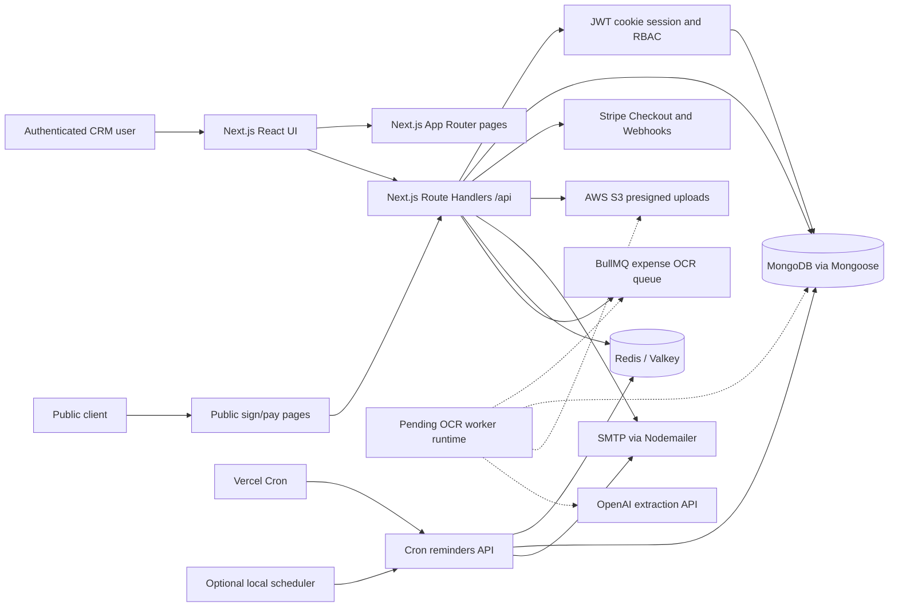
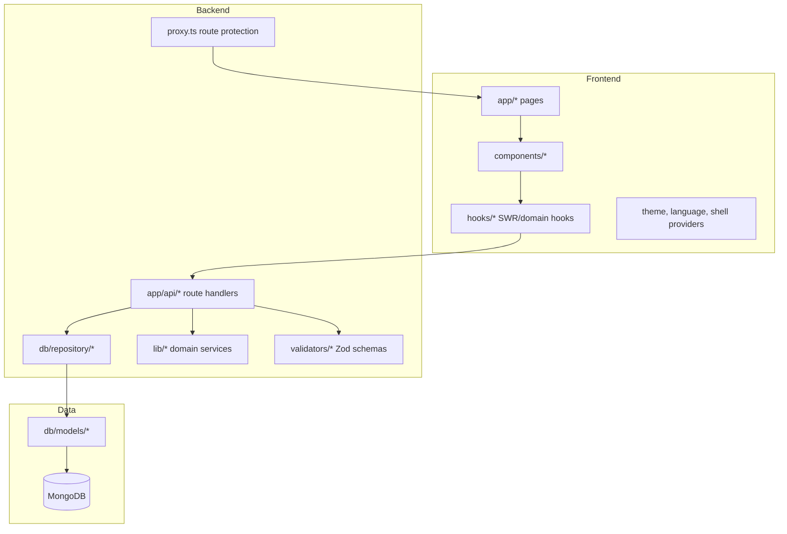
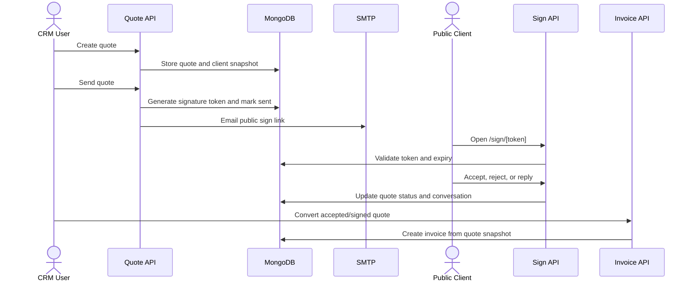
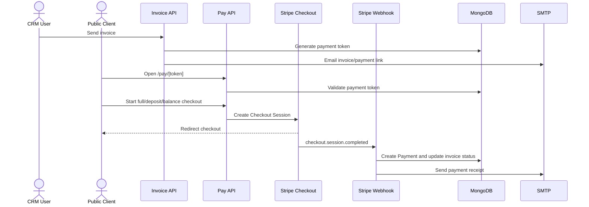
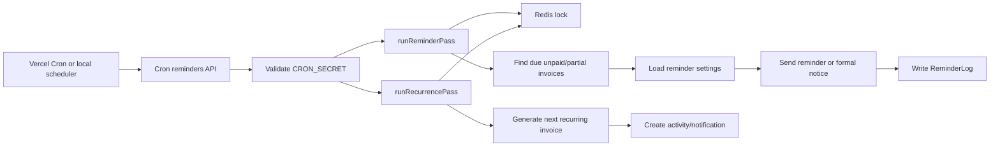

# CRM Roberto Technical Handover

Last updated: 2026-07-13

## 1. Executive Summary

CRM Roberto is a full-stack, multi-workspace business platform built with Next.js App Router, TypeScript, MongoDB/Mongoose, Stripe, AWS S3, Redis, and SMTP email. It comprises the Company CRM, Super Admin portal, and Accountant Portal, and centralizes CRM records, supplier management, expenses, tickets, quotes, invoices, accounting exports, public e-signature, payment collection, reminders, and recurring invoice generation.

Uploaded draft expense extraction includes OCR queue and worker source backed by Valkey and OpenAI. The worker is not yet packaged as a deployable runtime: its dependencies and npm script are absent from `package.json`.

The system is designed around three core business guarantees:

- A company/user must only access its own operational data.
- Commercial documents must preserve accounting snapshots at the time of issue.
- Public actions such as quote signing and invoice payment must be token-gated and auditable.

## 2. High-Level Architecture

Cron endpoint: `/api/cron/reminders`. Transactional email is sent synchronously from the web and cron processes via SMTP; no separate email worker exists.

## 3. Runtime Architecture

## 4. Repository Map

| Path | Responsibility |
|---|---|
| `app/` | App Router pages, layouts, metadata, loading/error states, and API route handlers. |
| `app/api/` | Backend endpoints for auth, CRM, expenses, quotes, invoices, payments, uploads, cron, notifications, Super Admin, Accountant Portal, exports, and dashboard data. |
| `components/` | Reusable UI and feature components for dashboards, CRM, invoices, quotes, expenses, tickets, onboarding, modals, and shell/navigation. |
| `hooks/` | Client-side data hooks for lists, action counts, details, lookups, dashboard data, auth, and sidebar badges. |
| `db/models/` | Mongoose schema definitions and indexes. |
| `db/repository/` | Data access and cross-model operations. |
| `lib/` | Domain logic for auth tokens, pricing, quote/invoice calculations, permissions, payments, Stripe, reminders, recurrence, PDF, i18n, and tickets. |
| `utils/` | Server middleware helpers, OTP/Redis, S3 client, and API utilities. |
| `validators/` | Zod schemas for request payloads and form validation. |
| `emails/` | SMTP transport and transactional email templates. |
| `cron/` | Optional local scheduler for reminder cron execution. |
| `workers/` | OCR worker source for uploaded expense drafts. It requires packaging work before it can run in deployment. |
| `docs/` | Handover, deployment, API, schema, and milestone documentation. |

## 5. Main Application Modules

| Module | Routes | Purpose |
|---|---|---|
| Authentication | `/login`, `/signup`, `/forgot-password`, `/workspace-setup`, `/logout` | Login, OTP verification, password reset, invited user onboarding, workspace bootstrap. |
| Dashboard | `/dashboard` | KPIs, activity, smart actions, reminders, follow-ups, and ticket summary. |
| Clients | `/clients` | Client CRUD, billing/contact data, notes, interactions, attachments. |
| Suppliers | `/suppliers` | Supplier CRUD, category/tag management, supplier notes. |
| Catalogue | `/catalogue` | Products and services used in quote/invoice line items. |
| Quotes | `/quotes` | Commercial quote creation, sending, PDF, status changes, client reply, signing, duplication. |
| Invoices | `/invoices` | Invoice creation, PDF, send flow, payments, reminders, legal recovery, recurrence. |
| Expenses | `/expenses` | Expense drafts, activation, categories, suppliers, attachments, payments, archive, audits. |
| Tickets | `/tickets` | Company-scoped tickets, messages, assignment, status, unread tracking, attachments. |
| Notes | `/notes` | Follow-ups linked to clients or suppliers. |
| Settings | `/settings` | User administration, roles, reminders, recovery rules, payment settings. |
| Profile | `/profile` | User/company profile and guided tour reset. |
| Public Sign | `/sign/[token]` | Tokenized quote signature and reply flow without CRM login. |
| Public Pay | `/pay/[token]` | Tokenized invoice payment flow without CRM login. |
| Company CRM exports | `/exports` | Company-scoped accounting rows, general ledger, and VAT-summary exports when the feature is enabled. |
| Super Admin | `/admin` | Separate platform portal for companies, feature/license controls, users, and platform logs; protected by `admin-token`. |
| Accountant Portal | `/accountant-portal` | Separate accountant workspace for financial dashboard, sales/purchase invoices, exports, and tickets; protected by `accountant-token` and the company feature flag. |

Portal entry points are `/login`, `/admin/login`, and `/accountant-portal/login`. New company workspaces are created through `/workspace-setup`; invited users use their invitation link to establish their account.

Expense OCR runtime notes:

- Only uploaded attachment-backed draft expenses are enqueued for OCR.
- Manual expense creation through `POST /api/expenses` is unchanged and does not use the queue.
- The worker only patches expenses that remain in `draft` status and only fills fields that are still empty or default-generated.

## 6. Authentication And Authorization

Authentication uses signed JWTs stored in HTTP-only cookies. Normal CRM sessions use `token`, Super Admin sessions use `admin-token`, and Accountant Portal sessions use `accountant-token`.

JWT payload fields include `sub`, `name`, `email`, `locale`, `isOnboardingComplete`, `isEmailVerified`, `role`, and `companyId`. Tokens are issued for seven days by `lib/auth-session.ts`.

`proxy.ts` protects CRM page routes and handles onboarding redirects. Public signature routes are bypassed at the page middleware level. API route handlers perform server-side checks through `utils/middlewares/checkMe.ts` and `utils/middlewares/useMe.ts`.

Roles are defined in `lib/permissions.ts`:

| Role | Intended access |
|---|---|
| `super_admin` | Full permissions. |
| `administrator` | Users, expenses, tickets. |
| `manager` | User viewing, expenses, tickets. |
| `standard_user` | Expenses and tickets. |
| `secretary` | Expenses and tickets. |
| `technician` | Tickets. |
| `read_only` | Read access for users, expenses, tickets. |
| `external_accountant` | Explicitly blocked from normal protected CRM routes. |

Security controls currently present:

- Argon2 password hashing with `PASSWORD_PEPPER`.
- JWT secret validation through `JWT_SECRET`.
- Account status checks for suspended users.
- Access revocation and forced logout timestamps.
- Failed login counters and temporary lock fields on `User`.
- Invitation status and hashed invitation tokens.
- Company context enforcement for company-scoped workflows, accountant data, exports, and feature-gated modules.
- Portal-specific session cookies and redirects prevent an external accountant from entering normal Company CRM routes.
- Stripe webhook signature verification.
- Cron endpoint secret validation through `CRON_SECRET`.

## 7. Core Business Flows

### Quote To Signature To Invoice

### Invoice Payment

### Reminder And Recurrence Automation

Cron endpoint: `/api/cron/reminders`.

## 8. Integration Architecture

| Integration | Files | Behavior |
|---|---|---|
| MongoDB | `db/connectDb.ts`, `db/models/*` | Cached Mongoose connection and schema models. |
| Stripe | `lib/stripe.ts`, `app/api/stripe/*`, `app/api/pay/[token]/*` | Checkout sessions, connected account setup, webhook verification, payment finalization, receipts. |
| AWS S3 | `utils/s3/s3Client.ts`, upload route handlers | Presigned uploads for general files, company logos, expense attachments, ticket attachments, and catalogue attachments. |
| SMTP | `emails/connectEmailClient.ts`, `lib/email.ts`, `emails/*` | Synchronous transactional auth, invitation, quote, invoice, reminder, legal notice, ticket, recurrence, and receipt emails. |
| Redis | `utils/otp/connectRedis.ts`, `lib/cron/redis-lock.ts` | OTP workflows and cron idempotency locks. |
| Vercel Cron | `vercel.json`, `app/api/cron/reminders/route.ts` | Twice-daily reminder/recurrence execution. |
| Accountant exports | `app/api/accountant/exports/*`, `app/api/exports/*` | Company-scoped accounting rows, general ledger, and VAT summary exports. |

## 9. Security And Audit Notes

Immediate handover security actions:

- Rotate every secret that appeared in local files, chat, screenshots, or ZIPs before final production delivery.
- Ensure `.env.local` is ignored and never included in public GitHub repositories or non-secure ZIP archives.
- Configure Stripe webhook endpoint as `/api/stripe/webhook` and verify `STRIPE_WEBHOOK_SECRET` in production.
- Use least-privilege IAM credentials for S3 and restrict bucket CORS to the production domain.
- Add platform-level rate limiting for login, password reset, public sign/pay token endpoints, and upload presign endpoints.
- Review every data query for correct `companyId` or owner scoping before opening multi-company access.
- Store production secrets only in the hosting provider secret manager.

Auditability already present:

- `AuditLog` captures expense, invoice, supplier, user, and ticket actions.
- `ActivityLog` feeds dashboard activity and unread states.
- `ReminderLog` records sent, skipped, failed, paused, and resumed reminder events.
- `Payment` records Stripe/manual payment entries and receipt dispatch timestamps.

## 10. Future Roadmap

| Item | Status | Recommended implementation direction |
|---|---|---|
| OCR-assisted expense workflow | Source implemented; deployment packaging incomplete | Uploaded expense drafts are queued for BullMQ, OCRed from S3 attachments, mapped by OpenAI into structured draft suggestions, and patched conservatively without activating the expense automatically. Add the missing dependencies and npm worker script before deploying it. |
| Email expense import | Placeholder route exists | Complete inbound email provider setup, verify HMAC/secret, parse attachments, upload to S3, create draft expenses, and add audit events. |
| Attachment malware scanning | Post-MVP limitation | Uploaded files are stored in S3 after validation of type and size, but there is no antivirus or sandbox scanning pipeline yet. Add quarantine plus scan-before-release for production hardening. |
| Background jobs | Partially implemented | OCR worker source is present but is not currently runnable from the package manifest. Email/PDF processing is synchronous; queue it separately only after implementing that worker. |
| External accountant portal | Implemented | Separate feature-gated accountant interface with scoped financial data, sales/purchase invoices, exports, and tickets. |
| Security hardening | Ongoing | Add rate limiting, request logging, structured audit reports, MFA, and automated dependency scanning. |
| Scale readiness | Ongoing | Add observability, database index validation, S3 lifecycle rules, queue-based email delivery, and load testing for dashboard aggregates. |

## 11. Known Post-MVP Limitations

- Full mailbox ingestion is not complete. The expense email ingest route is a protected placeholder that accepts validated payloads, but it does not yet include provider-specific inbound mailbox setup, signature verification beyond the shared secret, or autonomous mailbox polling.
- Attachment malware scanning is not implemented. Uploads are validated for size and MIME/extension expectations, but there is no antivirus scan, quarantine bucket, or asynchronous file reputation workflow before files become available for download.
- Platform rate limiting is still a hardening follow-up. Login, password reset, tokenized public routes, and upload-related endpoints should move behind request throttling before a broader production rollout.
- An OCR worker must not be deployed from the current package manifest: `bullmq`, OCR libraries, and `worker:expenses-ocr` are missing from its declared dependencies/scripts.
- There is no standalone email worker in the current codebase. SMTP sending runs within web requests and reminder cron execution.

## 12. Developer Handover Checklist

- Read all docs in `docs/`.
- Run `npm install`, `npm run lint`, and `npm run build` locally.
- Create local `.env.local` from `.env.example` without real production secrets unless authorized.
- Confirm MongoDB indexes for invoices, quotes, payments, expenses, tickets, reminders, and audit logs.
- Verify all production environment variables in the hosting provider.
- Confirm Stripe webhook delivery and SMTP sending in staging.
- Confirm S3 upload, read, delete, and lifecycle behavior in staging.
- Verify reminder cron with a test invoice and non-production recipient.
- Review role access for administrator, manager, technician, read-only, and external accountant.
- Produce a final source ZIP excluding `.env.local`, `.git`, `node_modules`, `.next`, and local temporary files.